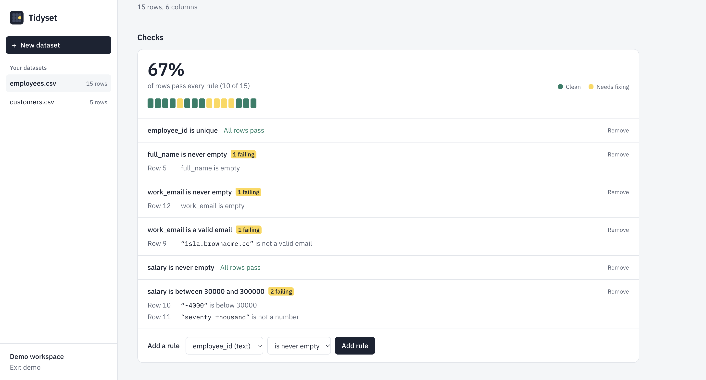
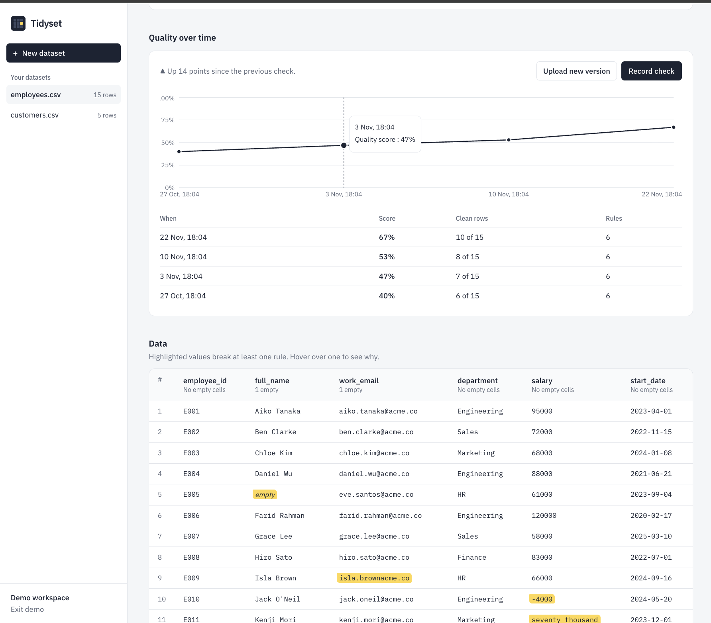

# Tidyset

Data quality monitoring for teams that work with spreadsheets. Upload a dataset, define what clean data looks like, and see every value that breaks your rules. Then track quality over time as the data changes.

**[Try the live demo](https://tidyset.vercel.app)**: click **Try the demo** on the login page. No sign-up needed.



## Why I built it

Before moving into software engineering, I worked as a data analyst at a bank. A big part of the job was data quality: finding duplicate IDs, missing fields and impossible values by hand, usually by scrolling through spreadsheets. Tidyset is the tool I wanted back then. You describe the rules once, and it shows exactly which rows break them and whether things are getting better.

## Features

- **Rule builder.** Never empty, unique, valid email, and number range rules. Tidyset detects whether each column holds numbers, emails, dates or text, and only offers rules that fit.
- **Quality score and row strip.** See the share of rows that pass every rule, plus one block per row so problems stand out at a glance.
- **Highlighted data table.** Every failing value is marked like a highlighter on a printout. Hover over it to see which rule it breaks.
- **History and trends.** Record checks over time, upload new versions of a dataset, and follow the quality score on a chart.
- **Private workspaces.** Email and password accounts. Each user can only ever see their own data, enforced by the database itself.
- **One-click demo.** Every visitor gets their own seeded sample workspace, so nobody can break the demo for the next person.



## Tech stack

| Area | Tools |
| --- | --- |
| Frontend | React 19, TypeScript, Vite, Tailwind CSS v4 |
| Backend | Supabase (Postgres, Auth, row-level security, RPC functions) |
| Charts and parsing | Recharts, Papa Parse |
| Testing | Vitest |
| Hosting | Vercel |

## Interesting decisions

**A pure TypeScript rule engine.** `src/lib/rules.ts` has no React or database code. Rows go in, failures come out. Rules are a discriminated union, so adding a new rule type makes the compiler point out every place that needs updating. The engine is covered by unit tests, including edge cases like inclusive range limits and duplicate detection.

**Security lives in the database.** Every table uses Postgres row-level security, and `user_id` defaults to `auth.uid()`. So even though the frontend talks to the database directly with a public key, users can only read and write their own rows. Rules also check that the dataset they're attached to belongs to the same user.

**Column type detection that tolerates bad data.** A column counts as "number" if at least 80% of its non-empty values are numeric, not 100%. A salary column with one `seventy thousand` in it is still treated as numeric, so the bad value gets flagged instead of confusing the detection.

**A safe demo without a shared password.** The demo uses Supabase anonymous sign-ins. A Postgres function (`security invoker`, so row-level security still applies) seeds sample data for each visitor. An advisory lock stops it from seeding twice when two requests arrive at once.

**Derived state over stored state.** Scores, failures and column types are calculated from the data on every render instead of being stored in React state, so they can never drift out of sync.

## Project structure

```
src/
  lib/          rule engine, CSV parsing, Supabase data layer, types
  components/   UI components (workspace, rule builder, results, chart, table)
supabase/       SQL for tables, security policies and the demo seed function
```

## Running locally

You need Node 20.19+ and a free [Supabase](https://supabase.com) project.

1. Clone the repo and install dependencies:
   ```bash
   git clone https://github.com/jaemgri/tidyset.git
   cd tidyset
   npm install
   ```
2. In Supabase, run the SQL files in `supabase/` in order (SQL Editor, then New query). Under **Authentication**, turn on **Allow anonymous sign-ins** for the demo.
3. Create `.env.local` in the project root with your project's URL and publishable key:
   ```
   VITE_SUPABASE_URL=https://your-project.supabase.co
   VITE_SUPABASE_PUBLISHABLE_KEY=sb_publishable_...
   ```
4. Start the dev server:
   ```bash
   npm run dev
   ```

Run the tests with `npm test`.

## What's next

- More rule types: allowed values, and dates that can't be in the future
- Organisations, so teammates can share datasets and assign fixes
- Scheduled checks against a connected database or Google Sheet
